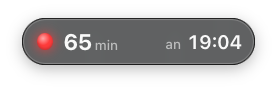
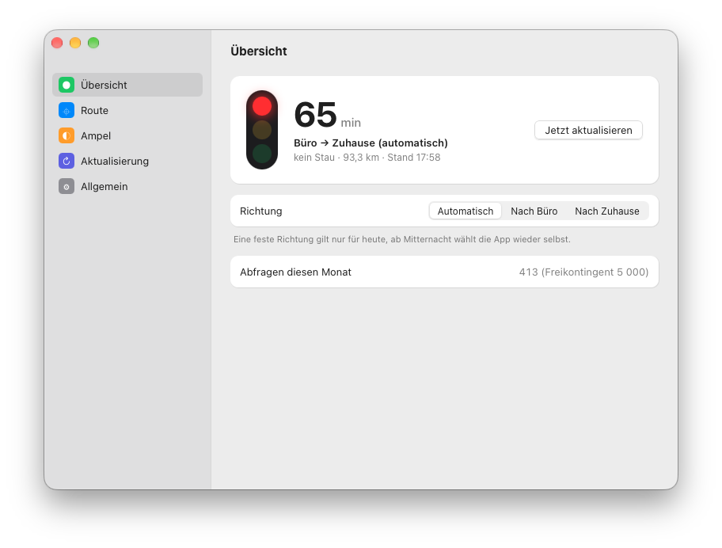
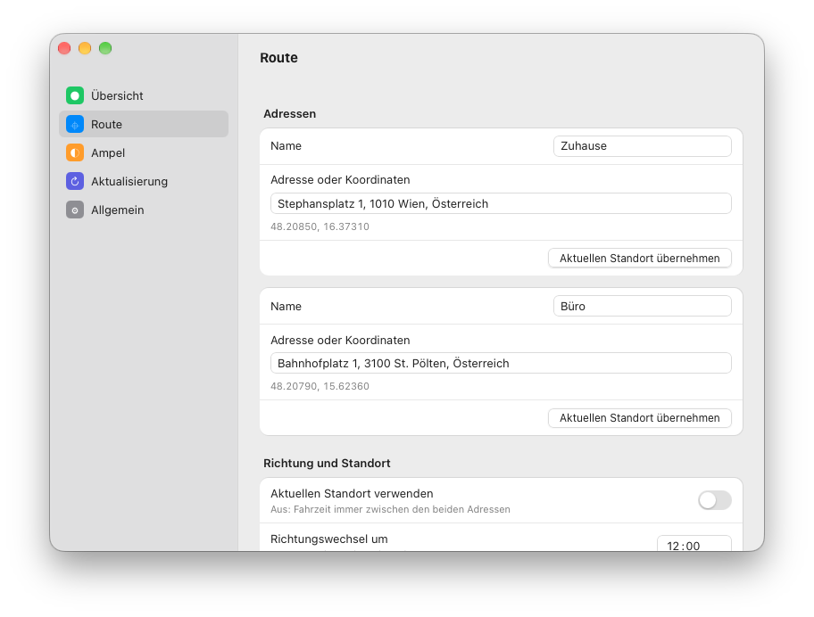
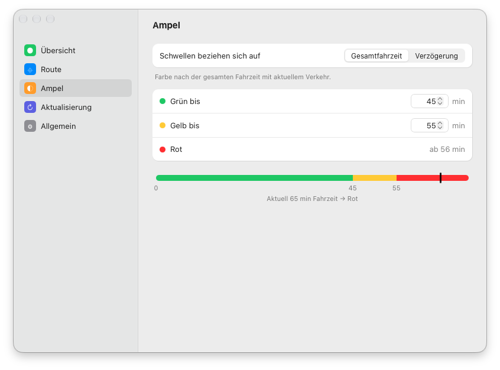
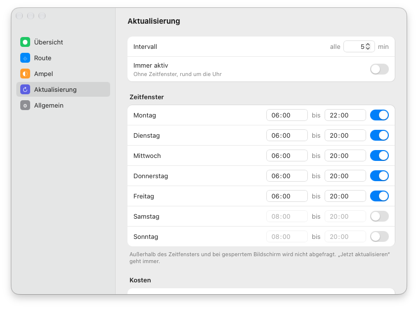
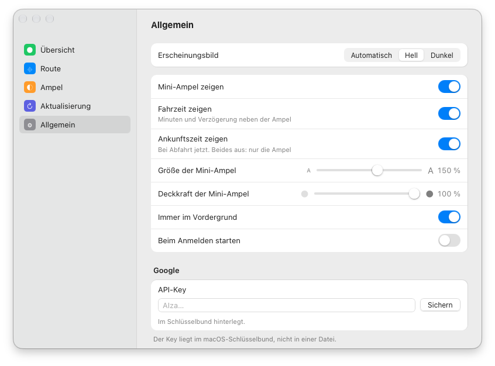
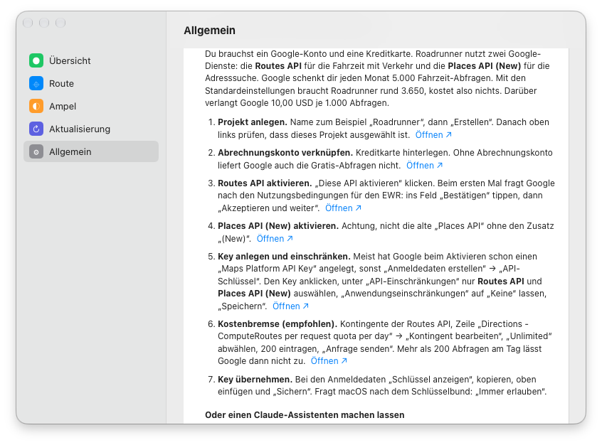
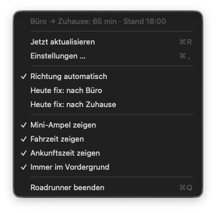
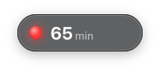
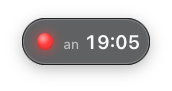

# Roadrunner

**Die Fahrzeit-Ampel für macOS und Windows.** Roadrunner zeigt, wie lange die Fahrt
zwischen Zuhause und Arbeit gerade dauert, mit aktuellem Verkehr, als kleine
schwebende Pille und in der Menüleiste. Grün, Gelb oder Rot auf einen Blick,
mit selbst gesetzten Schwellen.

[English version](README.md)

<p align="center">
  
  &nbsp;
  
</p>

<p align="center">
  
</p>

## Funktionen

- **Schwebende Pille**, die über anderen Fenstern bleibt, auf allen Spaces und
  auch über Vollbild-Apps (z.B. einer Parallels-VM im macOS-Vollbild). Ein
  Klick darauf nimmt der anderen App nicht den Fokus.
- **Ampel** mit zwei selbst gesetzten Schwellen, wahlweise bezogen auf die
  **Gesamtfahrzeit** oder auf die **Verzögerung durch Verkehr**.
- **Anzeige wählbar:** nur die Ampel, die Fahrzeit (mit Verzögerung), die
  Ankunftszeit bei Abfahrt jetzt, oder beides.
- **Richtung automatisch:** vor einer Wechselzeit zur Arbeit, danach nach
  Hause. Mit Standort zählt, wo du gerade bist.
- **Intervall und Wochenplan** einstellbar, damit du im Gratiskontingent von
  Google bleibst. Bei gesperrtem Bildschirm keine Abfragen.
- **Größe, Deckkraft und Hell/Dunkel** der Pille einstellbar.
- **Menüleiste** mit farbigem Punkt und Minuten.
- **API-Key im macOS-Schlüsselbund**, nie in einer Datei.
- Geschrieben in **Rust** mit [Tauri 2](https://tauri.app). Rund 7 MB. Eine Codebasis
  für macOS und Windows 11 (unter Windows im Windows-11-Stil).

## Screenshots

| | |
|---|---|
| <br>**Route:** Adressen mit Google-Vorschlägen oder eingefügten Koordinaten, Standort, Richtungswechsel | <br>**Ampel:** zwei Schwellen, Bezug Gesamtfahrzeit oder Verzögerung |
| <br>**Aktualisierung:** Intervall, Zeitfenster je Wochentag, hochgerechnete Abfragen pro Monat | <br>**Allgemein:** Erscheinungsbild, Inhalt der Pille, Größe, Deckkraft, API-Key |
| <br>**Eingebaute Anleitung** für den Google-API-Key, mit fertigem Auftrag für einen Claude-Assistenten | <br>**Rechtsklick-Menü** der Pille (gleich wie in der Menüleiste) |

Varianten der Pille (nur Ampel, Fahrzeit, Ankunftszeit, beides):

<p>
  
  &nbsp;
  
  &nbsp;
  
  &nbsp;
  
</p>

## Voraussetzungen

- macOS 12 oder neuer (getestet auf Apple Silicon) oder Windows 10/11 (x64 oder ARM64)
- Ein Google-Cloud-Projekt mit Abrechnungskonto und einem Key für die
  **Routes API** und die **Places API (New)** (siehe unten)
- Zum Bauen: [Rust](https://rustup.rs) und die Tauri-CLI

## Installation

### Download

Fertige Pakete hängen an jedem
[Release](https://github.com/flashkinx/roadrunner/releases):

| System | Datei |
|---|---|
| macOS (Apple Silicon und Intel) | `Roadrunner_<version>_universal.dmg` |
| Windows x64 | `Roadrunner_<version>_x64-setup.exe` |
| Windows ARM64 (z.B. Parallels auf Apple Silicon, Snapdragon-Laptops) | `Roadrunner_<version>_arm64-setup.exe` |

Die Pakete sind **nicht** mit einem kostenpflichtigen Zertifikat signiert,
deshalb warnen beide Systeme einmal:

- **macOS:** DMG öffnen, Roadrunner in "Programme" ziehen. Beim ersten Start
  verweigert macOS das Öffnen. Unter Systemeinstellungen → Datenschutz &
  Sicherheit auf "Dennoch öffnen" klicken, oder
  `xattr -dr com.apple.quarantine /Applications/Roadrunner.app` ausführen.
- **Windows:** SmartScreen meldet "Der Computer wurde durch Windows geschützt".
  "Weitere Informationen" → "Trotzdem ausführen". Installiert wird nur für den
  aktuellen Benutzer, ohne Administratorrechte.

### Selbst bauen

```sh
# 1. Rust (falls noch nicht da). Unter Windows zusätzlich die Visual Studio
#    Build Tools mit "Desktopentwicklung mit C++".
curl --proto '=https' --tlsv1.2 -sSf https://sh.rustup.rs | sh

# 2. Tauri-CLI
cargo install tauri-cli --version "^2" --locked

# 3. Bauen
git clone https://github.com/flashkinx/roadrunner.git
cd roadrunner/src-tauri
cargo tauri build

# 4. Installieren (macOS)
cp -R target/release/bundle/macos/Roadrunner.app /Applications/
open -a Roadrunner
# Windows: target\release\bundle\nsis\Roadrunner_*-setup.exe ausführen
```

Beim ersten Start öffnen sich die Einstellungen auf der Seite **Allgemein**,
die Anleitung ist schon aufgeklappt.

### Unterschiede macOS und Windows

| | macOS | Windows |
|---|---|---|
| Neben dem Symbol in Menüleiste/Infobereich | farbiger Punkt plus Minuten als Text | Minuten im farbigen Symbol (Windows kann dort keinen Text zeigen) |
| Optik | macOS-Glas (Vibrancy) | Windows-11-Mica und Fluent-Bedienelemente |
| API-Key | Schlüsselbund | Anmeldeinformationsverwaltung (Windows-Anmeldeinformationen, generisch) |
| Standort | Ortungsdienste | Windows-Standortdienst (Einstellungen → Datenschutz und Sicherheit → Standort) |
| Über Vollbild-Apps | ja, als nicht aktivierendes Panel | ja bei randlosem Vollbild, nicht bei exklusiven Vollbild-Spielen |

## Google-API-Key

Roadrunner nutzt zwei Google-Dienste: die **Routes API** für die Fahrzeit mit
Verkehr und die **Places API (New)** für die Adresssuche. Dieselbe Anleitung
steckt in der App (Allgemein → "So legst du den API-Key bei Google an"), mit
direkten Links in die Google Cloud Console.

1. **Projekt anlegen:** [console.cloud.google.com/projectcreate](https://console.cloud.google.com/projectcreate), z.B. "Roadrunner". Danach prüfen, dass es ausgewählt ist.
2. **Abrechnungskonto verknüpfen:** [Abrechnung](https://console.cloud.google.com/billing/linkedaccount). Ohne Abrechnungskonto liefert Google auch die Gratis-Abfragen nicht.
3. **[Routes API](https://console.cloud.google.com/apis/library/routes.googleapis.com) aktivieren.** Im EWR fragt Google zuerst nach den Nutzungsbedingungen (Bestätigungswort tippen, dann akzeptieren).
4. **[Places API (New)](https://console.cloud.google.com/apis/library/places.googleapis.com) aktivieren.** Nicht die alte "Places API".
5. **Key anlegen und einschränken:** [Anmeldedaten](https://console.cloud.google.com/apis/credentials). Oft legt Google automatisch einen "Maps Platform API Key" an. Nur auf **Routes API** und **Places API (New)** einschränken, Anwendungseinschränkungen "Keine".
6. **Kostenbremse (empfohlen):** In den Kontingenten der Routes API *Directions - ComputeRoutes per request quota per day* von unbegrenzt auf z.B. 200 setzen.
7. **Key einfügen** in Roadrunner unter Allgemein → API-Key → "Sichern". Fragt macOS nach dem Schlüsselbund: "Immer erlauben".

**Einen Claude-Assistenten machen lassen:** Die Anleitung in der App hat den
Knopf "Auftrag kopieren", mit einem fertigen Auftrag für einen Claude mit
Browsersteuerung (Claude in Chrome, Claude Code mit Browser). Er erledigt die
Schritte 1 bis 6 und überlässt Zahlungsdaten, Nutzungsbedingungen und das
Kopieren des Keys bewusst dir.

### Kosten

Fahrzeiten mit Verkehr rechnet Google als *Compute Routes Pro* ab: 5.000
Abfragen im Monat sind gratis, danach 10,00 USD je 1.000
([Preisliste](https://developers.google.com/maps/billing-and-pricing/pricing),
geprüft im November 2026). Mit den Standardwerten (alle 5 Minuten, Mo bis Fr
06:00 bis 20:00) rechnet Roadrunner rund 3.650 Abfragen im Monat hoch. Rund um
die Uhr wären es rund 8.770. Die Seite Aktualisierung zeigt die Hochrechnung
live, die Übersicht den tatsächlichen Monatszähler.

## Bedienung

- **Ziehen** verschiebt die Pille, **Doppelklick** öffnet die Einstellungen,
  **Rechtsklick** das Menü.
- **Mit der Maus darüber** stehen Strecke, Fahrzeit, Ankunft und der Stand des
  letzten Abrufs.
- **Menüleiste:** farbiger Punkt plus Minuten. Im Menü: aktualisieren,
  Einstellungen, feste Richtung für heute, Anzeigeoptionen, beenden.
- **Grau** heißt: kein aktueller Wert. Außerhalb des Zeitfensters, Bildschirm
  gesperrt oder der letzte Abruf ist gescheitert (der alte Wert bleibt mit
  Uhrzeit stehen).

### Wie die Richtung gewählt wird

- Ohne Standort: vor der Wechselzeit (Standard 12:00) zur Arbeit, danach nach
  Hause.
- Mit Standort: im Umkreis (Standard 500 m) von Zuhause zur Arbeit, im Umkreis
  der Arbeit nach Hause, sonst vom aktuellen Ort, Richtung nach Uhrzeit.
- Eine im Menü fixierte Richtung gilt bis Mitternacht.

Der Standort kommt aus den macOS-Ortungsdiensten (am Mac meist per WLAN) und
wird nur als Startpunkt in der Anfrage an Google verwendet.

## Datenschutz

- Der API-Key liegt im macOS-Schlüsselbund (Dienst
  `io.github.flashkinx.roadrunner`) bzw. in der Windows-Anmeldeinformations-
  verwaltung (Ziel `io.github.flashkinx.roadrunner/google-api-key`).
- Einstellungen: `~/Library/Application Support/io.github.flashkinx.roadrunner/config.json`
  am Mac, `%APPDATA%\io.github.flashkinx.roadrunner\config.json` unter Windows.
- Netzwerkanfragen gehen nur an Google (Routes API, Places API). Keine
  Statistik, keine anderen Server.

## Entwicklung

Befehle, Testmodus, Umgebungsvariablen und Aufbau stehen im
[englischen README](README.md#development).

## Lizenz

[MIT](LICENSE). Kein offizielles Google-Produkt.
