# Roadrunner

**A live commute traffic light for macOS.** Roadrunner shows how long the drive
between home and work takes right now, including traffic, as a small floating
pill and in the menu bar. Green, yellow or red at a glance, with your own
thresholds.

[Deutsche Version](README.de.md)

<p align="center">
  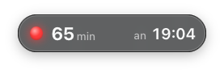
  &nbsp;
  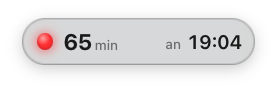
</p>

<p align="center">
  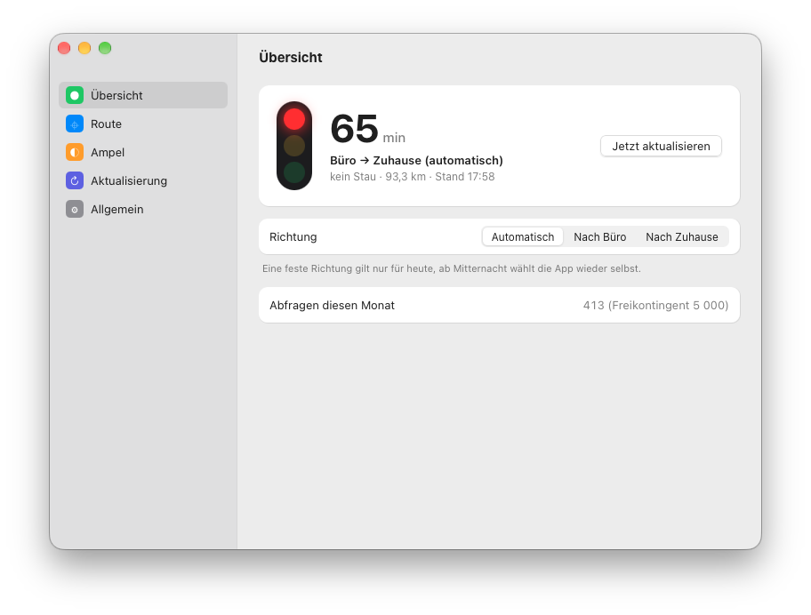
</p>

> The app's interface is currently **German only**. This README explains every
> screen in English.

## Features

- **Floating pill** that stays on top of other windows, on every Space and
  above full-screen apps (e.g. a Parallels VM in macOS full screen). Clicking it
  does not steal focus.
- **Traffic light** with two thresholds you set yourself, based either on the
  **total drive time** or on the **delay caused by traffic**.
- **Choose what the pill shows:** just the light, the drive time (with traffic
  delay), the arrival time if you leave now, or both.
- **Direction is automatic:** before a switch time it routes to work, after it
  back home. With location enabled, it uses where you actually are.
- **Refresh interval and weekly schedule** are adjustable, so you stay within
  Google's free tier. No requests while the screen is locked.
- **Size, opacity and light/dark appearance** of the pill are adjustable.
- **Menu bar item** with a colored dot and the minutes.
- **API key stored in the macOS Keychain**, never in a file.
- Written in **Rust** with [Tauri 2](https://tauri.app). About 7 MB.

## Screenshots

| | |
|---|---|
| 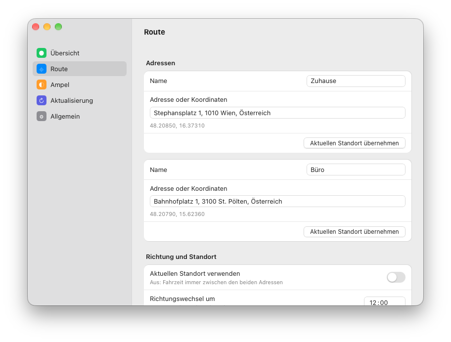<br>**Route** (Route): home and work address with Google autocomplete or pasted coordinates, location, direction switch time | 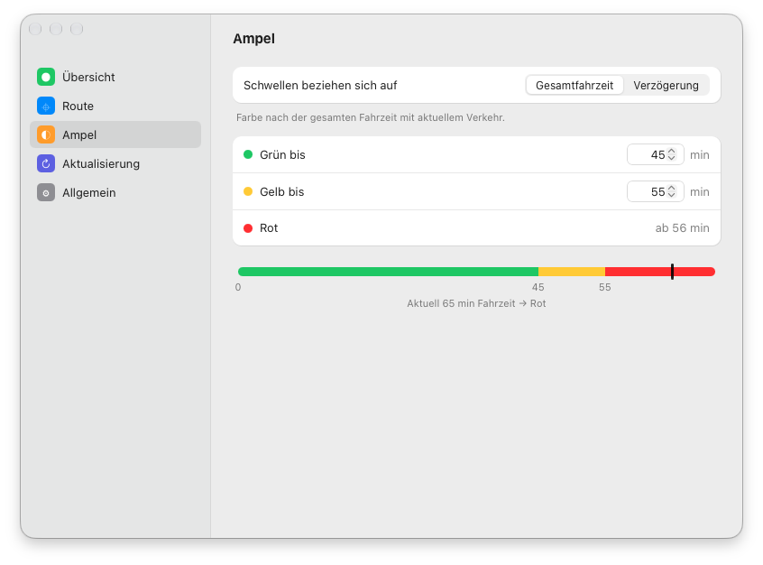<br>**Traffic light** (Ampel): two thresholds, based on total time or traffic delay |
| 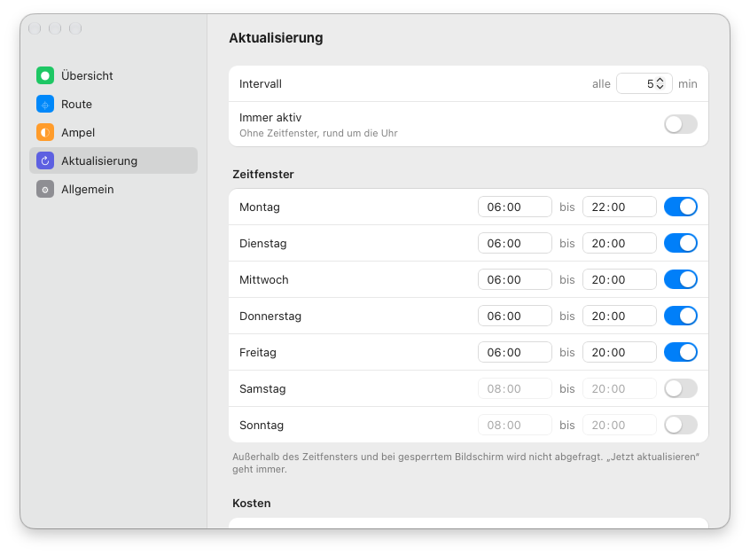<br>**Refresh** (Aktualisierung): interval, schedule per weekday, projected monthly requests | 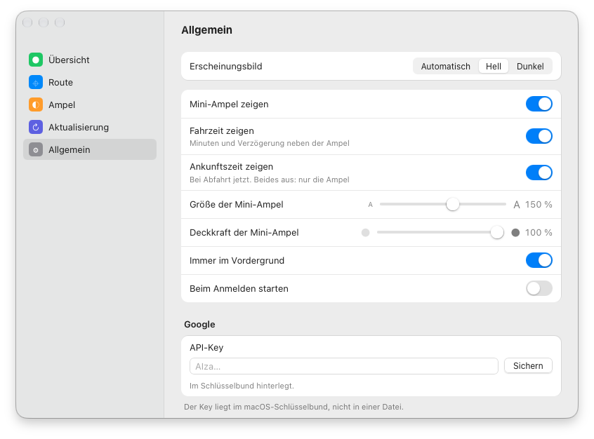<br>**General** (Allgemein): appearance, what the pill shows, size, opacity, API key |
| 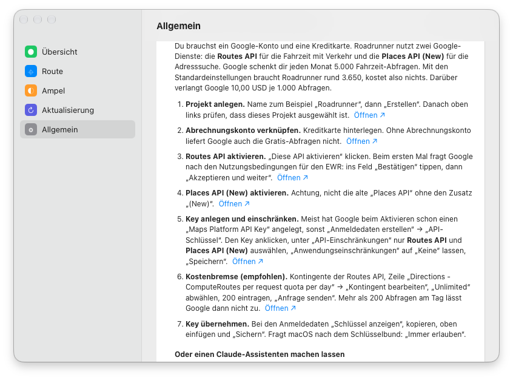<br>**Built-in guide** for creating the Google API key, including a ready-made prompt for a Claude assistant | 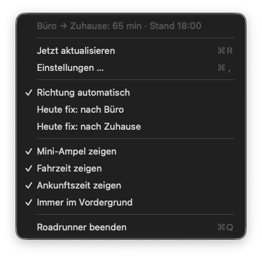<br>**Right-click menu** of the pill (same as the menu bar item) |

Pill variants (traffic light only, drive time, arrival time, both):

<p>
  
  &nbsp;
  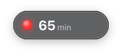
  &nbsp;
  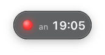
  &nbsp;
  
</p>

## Requirements

- macOS 12 or newer (tested on Apple Silicon)
- A Google Cloud project with billing enabled and a key for the **Routes API**
  and the **Places API (New)** (see below)
- To build: [Rust](https://rustup.rs) and the Tauri CLI

## Installation

There is no signed download yet. A Mac app that is not signed and notarized
with an Apple Developer ID is blocked by Gatekeeper when downloaded, so for now
you build it yourself. It takes a few minutes:

```sh
# 1. Rust (skip if installed)
curl --proto '=https' --tlsv1.2 -sSf https://sh.rustup.rs | sh

# 2. Tauri CLI
cargo install tauri-cli --version "^2" --locked

# 3. Build
git clone https://github.com/flashkinx/roadrunner.git
cd roadrunner/src-tauri
cargo tauri build

# 4. Install
cp -R target/release/bundle/macos/Roadrunner.app /Applications/
open -a Roadrunner
```

On first start the settings window opens on the **General** page with the
guide expanded.

## Google API key

Roadrunner uses two Google services: the **Routes API** for the drive time with
traffic and the **Places API (New)** for the address search. The same guide is
built into the app (General → "So legst du den API-Key bei Google an"), with
direct links into the Google Cloud Console.

1. **Create a project:** [console.cloud.google.com/projectcreate](https://console.cloud.google.com/projectcreate), e.g. "Roadrunner". Make sure it is selected afterwards.
2. **Link a billing account:** [Billing](https://console.cloud.google.com/billing/linkedaccount). Without one, Google does not serve even the free requests.
3. **Enable the [Routes API](https://console.cloud.google.com/apis/library/routes.googleapis.com).** In the EEA, Google first asks you to accept the EEA terms (type the confirmation word, then accept).
4. **Enable the [Places API (New)](https://console.cloud.google.com/apis/library/places.googleapis.com).** Not the legacy "Places API".
5. **Create and restrict the key:** [Credentials](https://console.cloud.google.com/apis/credentials). Google often creates a "Maps Platform API Key" automatically. Restrict it to **Routes API** and **Places API (New)** only, application restrictions "None".
6. **Spending cap (recommended):** in the Routes API quotas, set *Directions - ComputeRoutes per request quota per day* from unlimited to e.g. 200.
7. **Paste the key** in Roadrunner under General → API-Key → "Sichern". If macOS asks about Keychain access, choose "Always Allow".

**Let a Claude assistant do it:** the in-app guide has a "Auftrag kopieren"
button with a prompt for Claude with browser control (Claude in Chrome, Claude
Code with a browser). It does steps 1 to 6 and deliberately leaves payment
details, accepting terms and copying the key to you.

### Costs

Traffic-aware routes are billed as *Compute Routes Pro*: 5,000 requests per
month are free, then USD 10.00 per 1,000
([pricing](https://developers.google.com/maps/billing-and-pricing/pricing),
checked November 2026). With the defaults (every 5 minutes, Mon to Fri 06:00 to
20:00) Roadrunner projects about 3,650 requests per month. Running 24/7 would be
about 8,770. The Refresh page shows the projection live and the Overview page
the actual count for the month.

## Using it

- **Drag** the pill to move it. **Double-click** opens the settings,
  **right-click** opens the menu.
- **Hover** shows route, drive time, arrival time and the time of the last
  update.
- **Menu bar:** colored dot plus minutes. The menu offers refresh, settings,
  a fixed direction for today, show/hide options and quit.
- **Grey** means no current value: outside the schedule, screen locked, or the
  last request failed (the old value stays visible with its time).

### How the direction is chosen

- Without location: before the switch time (default 12:00) to work, after it
  home.
- With location: within the radius (default 500 m) of home → to work, within
  the radius of work → home, anywhere else from your current position, direction
  by time.
- A direction fixed from the menu applies until midnight.

The location comes from macOS Location Services (on a Mac usually Wi-Fi based)
and is only used as the route origin in the request to Google.

## Privacy

- The API key lives in the macOS Keychain (service
  `io.github.flashkinx.roadrunner`).
- Settings: `~/Library/Application Support/io.github.flashkinx.roadrunner/config.json`.
- Network requests go only to Google (Routes API, Places API). No analytics,
  no other servers.

## Development

```sh
cd src-tauri
cargo test          # logic tests (thresholds, direction, schedule, parsing)
cargo tauri dev     # run with live reload of the UI files
cargo tauri build   # .app bundle
```

Probe mode without UI (does not count towards the app's monthly counter):

```sh
B=target/release/roadrunner
$B --probe                                    # both directions, saved addresses
$B --probe --place "Stephansplatz 1, Wien"    # address search
$B --probe --from 48.2085,16.3731 --to 48.2079,15.6236
```

Environment variables:

| Variable | Purpose |
|---|---|
| `ROADRUNNER_API_KEY` | use this key instead of the Keychain |
| `ROADRUNNER_CONFIG_DIR` | separate config directory, e.g. a demo profile |
| `ROADRUNNER_PAGE` | open settings on `status`, `route`, `ampel`, `refresh`, `general` or `guide` |
| `ROADRUNNER_MENU=1` | open the pill menu a few seconds after start (screenshots) |

Project layout:

| Path | Contents |
|---|---|
| `src-tauri/src/config.rs` | settings, schedule, monthly counter |
| `src-tauri/src/ampel.rs` | minutes → color |
| `src-tauri/src/direction.rs` | direction, origin and destination |
| `src-tauri/src/google.rs` | Routes API, Places API, coordinate parser |
| `src-tauri/src/location.rs` | CoreLocation |
| `src-tauri/src/macos.rs` | Keychain, lock screen, panel/window level |
| `src-tauri/src/scheduler.rs` | refresh loop |
| `src-tauri/src/state.rs` | shared state, status distribution |
| `src-tauri/src/ui.rs` | menu bar, menus, pill size |
| `ui/` | pill and settings (plain HTML/CSS/JS, no bundler) |
| `tools/windows.swift` | lists Roadrunner's window IDs for `screencapture -l` |

Ad-hoc signed builds change their signature with every build, so macOS may ask
once for Keychain access after a rebuild.

## License

[MIT](LICENSE). Not affiliated with Google.
